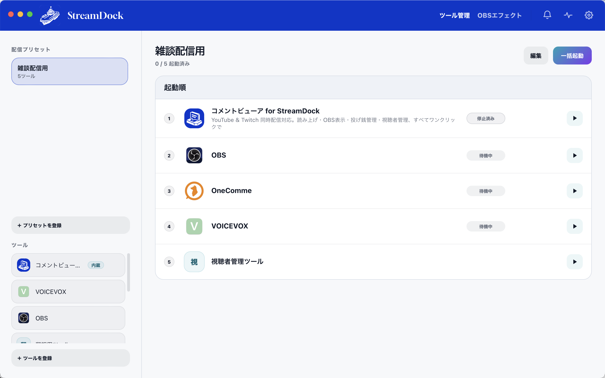
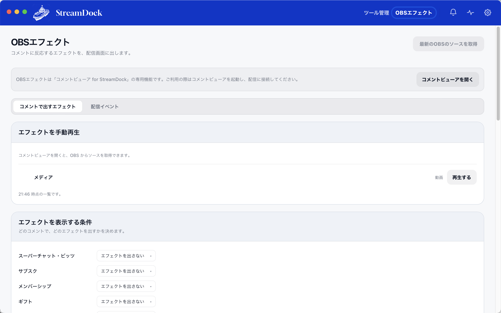
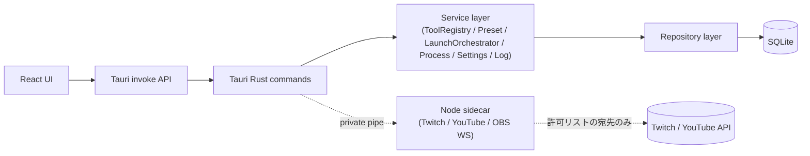

# StreamDock

> 配信前に毎回同じ手順でOBS・コメントビューア・読み上げなどを起動する面倒を、プリセットのワンクリック起動で解決するデスクトップアプリ


[](https://github.com/satoh23/StreamDock-releases/releases)

## デモ



## プロダクト概要

配信者は、配信を開始するまでにOBS、コメントビューア、読み上げソフト、翻訳ツール、アバターソフトなど、複数のアプリケーションを起動・設定する必要があります。

配信内容によって必要なツールは変わり、それぞれを毎回起動する手間や、起動順序・設定を確認する負担が発生します。

StreamDockは、こうした配信準備を**プリセットとして管理し、ワンクリックで実行できるデスクトップアプリ**です。

既存の配信ツールを置き換えるのではなく、配信者がすでに使っている環境を活かしながら、準備に必要な操作を減らすことを目指しています。

---

## 1. 開発の背景

開発当初は「配信中のコメント管理」を課題として想定していました。ただしこれは開発者自身の仮説に過ぎなかったため、X経由で同時接続30〜80人規模の配信者に直接アプローチし、Google Meetで個別インタビューを実施しました（文字起こし等は非公開の約束のもとで実施したため、本リポジトリには掲載していません）。

インタビューで見えてきたのは、コメント管理よりも**配信開始前の準備**——複数ツールの起動・設定確認や、コラボ配信時にDiscordのURLを調べてOBSへ設定するような手作業——の負担でした。この結果を受けて、プロダクトの軸を「コメント支援ツール」から「配信準備を自動化するデスクトップアプリ」へ転換し、コメントビューアはその中の一機能として位置づけ直しました。

v1.0.0リリース後、実際に使ってくれている配信者もいますが、準備時間の削減効果や継続利用率などの定量検証はまだこれからです。

インタビュー手法・仮説の見直し過程・今後の検証計画の詳細は [docs/product-story.md](docs/product-story.md) にまとめています。

---

## 2. 主な機能

### 配信準備の自動化

- ツール登録・プリセット作成、プリセットごとに起動順/並行起動を設定
- 一括起動・個別起動、StreamDock経由で起動したプロセスだけを安全に一括停止
- 起動状態のリアルタイム表示、PC起動時のプリセット自動起動

### 内蔵コメントビューア

- Twitch・YouTubeのコメントを同時取得してマージ表示（OAuthトークンはOSキーチェーンに保存）
- VOICEVOXによる直接音声合成読み上げ（読み替え辞書つき）
- OBS用の透過オーバーレイウィンドウ、実視聴者アイコン表示
- コメント種別（スーパーチャット／サブスク／メンバーシップ／ギフト）に応じたOBSエフェクト自動再生

### 配布・運用

- macOS(Universal)・Windows(x64)インストーラをGitHub Actionsで自動ビルド
- Windowsはクラウド署名、アプリ自身の自己アップデート機能つき

<table>
<tr>
<td><br/><sub>コメント種別ごとにOBSエフェクトの発火条件を設定</sub></td>
<td><br/><sub>Twitch / YouTube コメントを同時表示する内蔵ビューア</sub></td>
</tr>
</table>

---

## 3. アーキテクチャ・技術スタック

| レイヤー           | 技術                                                          |
| ------------------ | --------------------------------------------------------------- |
| UI                 | React 19 + TypeScript（Vite）                                 |
| デスクトップシェル | Tauri 2                                                       |
| バックエンド       | Rust                                                          |
| データ永続化       | SQLite                                                        |
| 配信コメント取得   | Node.js sidecar（単一実行ファイル化／gRPC／obs-websocket-js） |
| パッケージ管理     | pnpm workspace（モノレポ）                                    |



StreamDock本体（mainプロセス）はインターネットに直接出ない。外部通信が必要なコメント取得だけを、隔離したNode sidecarに封じ込めている。

---

## 4. 技術的に工夫した点

### 外部通信は既定で禁止、例外は許可リスト方式

本体は原則ネット通信をしない。

Twitch/YouTubeのコメント取得のみ、ユーザーの明示操作+宛先許可リスト+Node sidecarへの封じ込めという条件つきで例外許可している。

詳細は [docs/security.md](docs/security.md) を参照。

### OAuthトークンはOSキーチェーンに保存

ログにも外部にも出さず、Twitch/YouTube両方で同じ方式に統一。

### チケット制の認可で未認証WSからの不正操作を防止

チャット書き込み機能では、Rustが発行したチケットをstdinのプライベートパイプでNode sidecarへ渡し、sidecar側で定数時間比較・スロットルする。

frontend側に置くと未認証WS経由で回避されるため、検証はsidecar側にだけ置いている。

### 個人開発者でもコード署名できる配信基盤を構築

当初Azure Trusted Signingを想定したが、日本在住の個人開発者は対象外と判明。

SSL.com eSignerのクラウド署名に切り替え、GitHub Actions上で完結する署名パイプラインを構築した。

Updater用のminisign署名とコード署名の経路を分離し、ビルド後に成果物のバイト列を変えない設計にして自己更新の破損を防いでいる。

### テストの実効性をミューテーションテストで検証

カバレッジ数値だけでなく、意図的にロジックを壊してテストが落ちるかを手動で確認し、守られていなかった箇所を実際に発見・修正した。

---

## 5. 開発プロセス（AIとの協働について）

このプロジェクトはClaude Code（AIペアプログラミング）を使って開発しています。

AIによって実装速度を高める一方で、品質や安全性を維持するため、計画・実装・レビュー・検証を分離した開発プロセスを採用しました。

### 5.1 自分自身が担当した意思決定

- ユーザーインタビューの企画・実施
- ユーザー課題の分析とインサイトの仮説設定
- プロダクトの方向転換と機能の優先順位付け
- 要件定義と実装方針の決定
- セキュリティ要件と設計上の制約の策定
- AIが提示した実装計画や変更内容のレビュー
- テスト・検証方針の策定
- リリースと運用上の意思決定

AIは実装・調査・レビューの支援に利用しましたが、プロダクトの方向性や採用する設計については、開発者自身が判断する形で進めました。

### 5.2 実装前の計画・承認

実装前に計画と対象ファイルを提示し、承認を得てから着手するルールを設けています。

詳細は [CLAUDE.md](CLAUDE.md) を参照。

### 5.3 セキュリティレビューと攻撃者視点の検証

OS操作・ファイル操作・プロセス操作・外部通信に関わる変更は、[docs/security.md](docs/security.md) の基準に基づくレビューを必須としています。

そのレビューとは**別セッション・別ロールで攻撃者視点の検証**も実施しています。

チェックリスト型のレビューは守り側の前提に乗ってしまいがちなので、「誰が・どこから・何を送れるか」という攻撃者モデルを [docs/security-threats.md](docs/security-threats.md) に台帳化しました。

見つけた穴は「危ないかも」で終わらせず、再現テストに固定してから完了としています。

### 5.4 意思決定の記録

意思決定とレビュー結果は [docs/progress.md](docs/progress.md) に記録し、後から経緯を追えるようにしています。

`docs/tasks/` には178件の設計ドキュメントがあります。

### 5.5 小さな差分による開発

1回の作業で複数機能をまとめて実装しない方針を採用しました。

タスクを小さく分割し、差分をレビュー可能な単位に保つことで、AIが生成したコードの変更範囲と影響を追いやすくしています。

### 5.6 AI開発に対する考え方

AIを利用することで、一人でも複数の技術領域にまたがるアプリケーションを開発しやすくなりました。

一方で、AIが生成したコードが正しいことや、安全であることが自動的に保証されるわけではありません。

そのため、AIに実装を任せること自体よりも、**何を作るかを自分で判断し、どのような基準で設計・実装を承認し、どう検証するか**を重視しました。

このプロジェクトでは、プロダクト企画からリリースまでを個人で進めるための手段としてAIを活用しています。

---

## 6. クイックスタート

必要要件: Node.js 20以上 / pnpm 10以上 / Rustツールチェイン

```sh
pnpm install
pnpm tauri dev
```

初回はRust側のビルドに数分かかる。

```sh
pnpm typecheck   # tsc --noEmit
pnpm lint        # eslint
cd apps/desktop/src-tauri && cargo check
```

署名・自己アップデート・リリース手順など配布まわりの詳細は [docs/release.md](docs/release.md) を参照。

---

## 7. プロジェクトの状況

- v1.0.0 リリース済み（2026-09-06、開発開始は2026-07-05）
- frontend 2308テスト（Vitest） / Rust 475テスト
- `docs/tasks/` 配下に178件の設計ドキュメント
- 通常はソースコードをprivateで運用
- 配布物のみ別のpublicリポジトリ（[StreamDock-releases](https://github.com/satoh23/StreamDock-releases)）で公開

本リポジトリのソースコードは、開発内容や設計上の意思決定を確認できるよう、選考・ポートフォリオ閲覧を目的として一時的に公開しています。

---

## 8. ライセンス

未設定。

ソースコードの公開は、第三者に対して利用・改変・再配布等を許諾するものではありません。

## 作者

Tetsuya Satoh — [@satoh23](https://github.com/satoh23)
